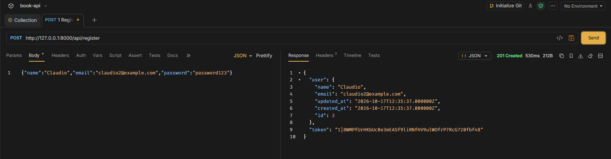
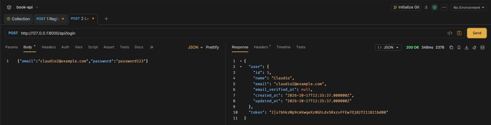
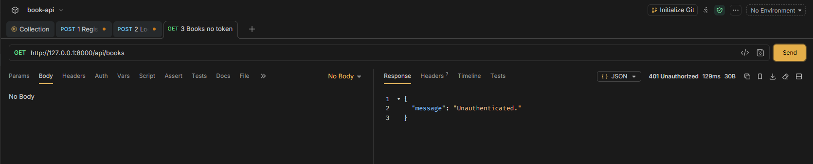
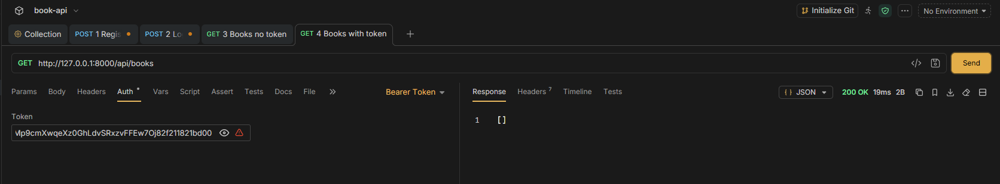
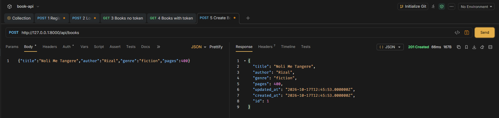
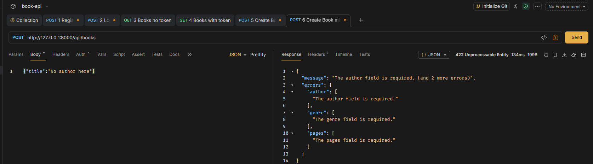
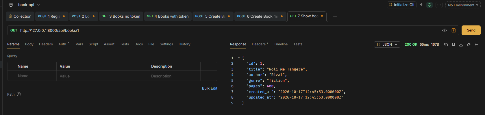
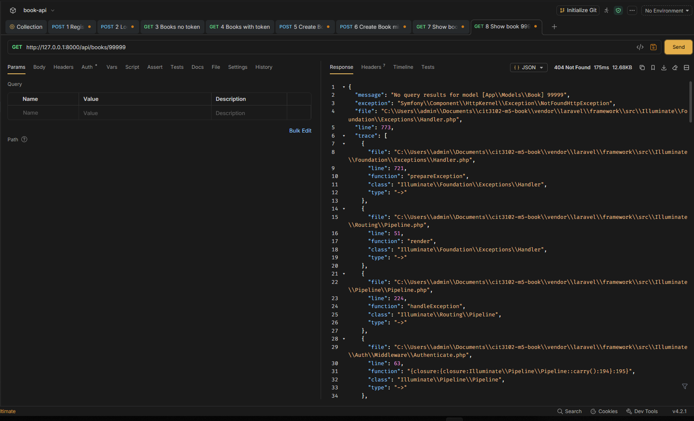
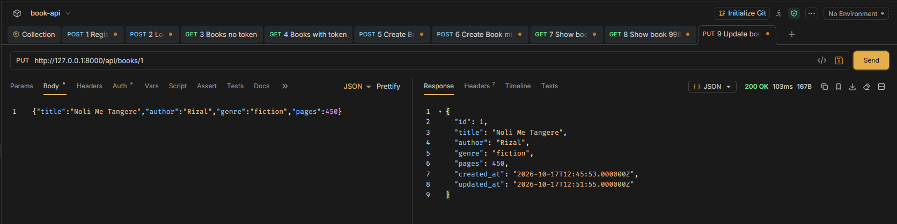
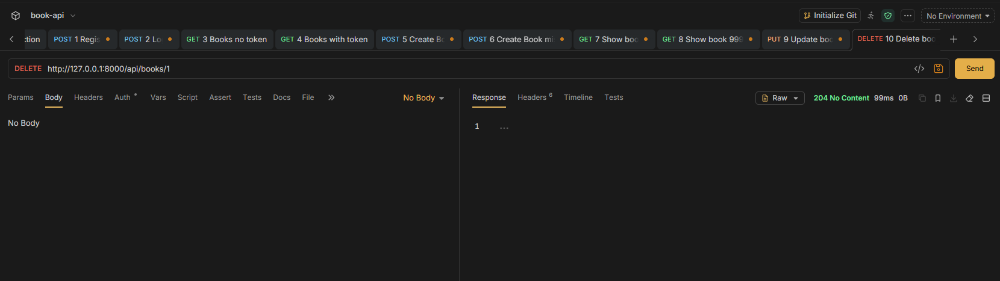

## 1. Project Information
* **Project Title:** Build Your Own API (BOOK API)
* **Partner 1:** <Padua, Justine Bryan R.>
* **Section:** BSIT-IT2E
* **Resource:** Book (Fields: `title` [String], `author` [String], `genre` [String], `pages` [Integer])

## 2. Setup Steps (Fresh Clone)
1. Clone the repository:
```
   git clone https://github.com/Claudioo08/cit3102-m5-book.git
   cd cit3102-m5-book
```
2. Install PHP dependencies:
```
   composer install
```
3. Configure environment:
```
   cp .env.example .env
   php artisan key:generate
```
4. Create the SQLite database file:
```
   touch database/database.sqlite
```
   On Windows PowerShell, use `New-Item database/database.sqlite` instead.
5. Run migrations:
```
   php artisan migrate
```
6. Start the development server:
```
   php artisan serve
```

## 3. API Routes Table

| Verb | Path | What it does | Needs Token? |
| :--- | :--- | :--- | :--- |
| POST | /api/register | Creates a new user and returns a token | No |
| POST | /api/login | Logs in and returns a token | No |
| POST | /api/logout | Revokes the current token | Yes |
| GET | /api/me | Shows the logged-in user | Yes |
| GET | /api/books | Lists books (filter with ?genre= and ?author=) | Yes |
| POST | /api/books | Creates a book | Yes |
| GET | /api/books/{book} | Shows one book | Yes |
| PUT | /api/books/{book} | Updates a book | Yes |
| DELETE | /api/books/{book} | Deletes a book | Yes |

## 4. API Testing Screenshots

1. POST /api/register (201)



2. POST /api/login (200)



3. GET /api/books with no token (401)



4. GET /api/books with token (200)



5. POST /api/books with valid data (201)



6. POST /api/books with a required field missing (422)



7. GET /api/books/1 (200)



8. GET /api/books/99999 (404)



9. PUT /api/books/1 (200)



10. DELETE /api/books/1 (204)



## 5. Why does DELETE return 204 and not 200?

DELETE returns 204 because the delete worked, but there is nothing to send back. After the book is deleted, it does not exist anymore, so there is no data to show in the response. A 200 status usually comes with a body, like the book or a message. A 204 status has an empty body, and the status code alone tells the client that it worked.